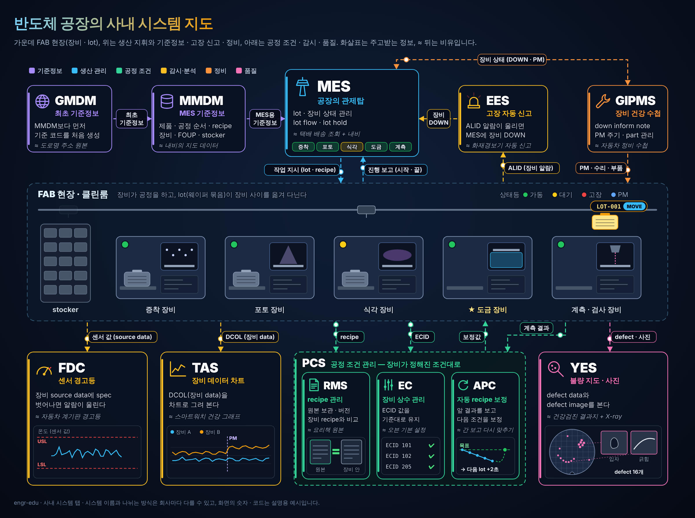
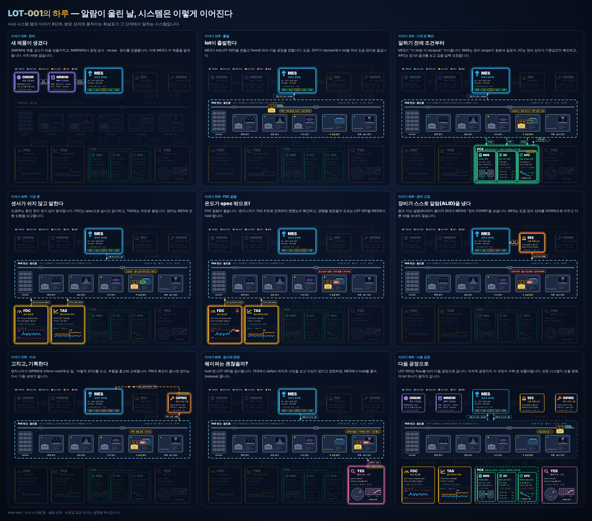

# engr-edu — 신입 엔지니어 교육과 업무 알고리즘 맵

반도체 제조 현장에 새로 온 엔지니어가 **기초를 배우고**, 선배에게 배운 업무를 **흐름도(업무 알고리즘)로 남겨 다시 쓸 수 있게** 돕는 프로그램입니다.

**`dist/engr-edu.html` 파일 하나만 받아서 더블클릭하면 됩니다.** 설치, 서버, 인터넷 연결이 필요 없고 외부 CDN도 쓰지 않아서 사내망에서도 그대로 열립니다 (Chrome·Edge 권장).

## 구성

| 탭 | 내용 |
|---|---|
| **교육과정** | 엔지니어의 마인드, 자주 부딪히는 업무 상황, 공학·반도체·제조기술의 기초, 업무 알고리즘 작성법, 참고 자료 (8개 모듈) — 그림 46개, 직접 조작하는 시뮬레이터 6종, 참고 링크 40여 개 |
| **업무 알고리즘 맵** | 글로 적은 업무를 도형(흐름도)으로 바꾸고, 노드마다 설명·주의점·사진을 붙여 정리 |
| **HBM 역추적** | AI 데이터센터(12 m)에서 DRAM 셀(수십 nm)까지 스크롤할 때마다 줌인하며 "이건 어디서 왔지?"를 거꾸로 따라가는 이야기 (12개 장면, 약 1억 배) |
| **범프 공정** | 앞면 범프 도금 12단계를 **웨이퍼 · 다이 · 범프** 세 단위로 한 화면에서 순서대로 (PVD Ti/Cu → … → 스크러버) |
| **전해도금** | 도금의 원리부터 현장까지 **13장** — 도금조 · 패러데이 법칙 · 이온이 오는 길 · 과전압 / 첨가제 · 막의 속 · 웨이퍼 분포 · 패턴 효과 / 장비 해부 · Cu·Ni·SnAg · 도금액 관리 · 불량 도감 · 인자 지도. 쉬운 설명 + 비유 + 장면을 바꾸는 직접 해 보기 + 「한 걸음 더(전문)」 |
| **PR 스트립** | 도금이 끝난 뒤 PR 틀을 걷어 내고 범프는 지키기 — **9장**: 왜 걷어 내나 · PR의 정체(녹기 vs 부풀어 떨어지기) · 스며들기 / 스트리퍼 약품 · 장비(배치 · 매엽) · 액 수명 / 금속 지키기 · 잔여물과 검사 · 불량 도감 |
| **시드 식각** | 범프 사이의 시드(Ti + Cu)를 녹여 범프를 하나씩 떼어 놓기 — **9장**: 왜 지우나 · 녹는 원리 · 속도의 열쇠 / 언더컷 · 갈바닉 · Ti 식각과 선택비 / 끝점 · 장비와 식각액 · 불량 도감 |
| **리플로우** | SnAg 솔더를 녹여 둥글게, 계면을 IMC로 잇기 — **9장**: 왜 녹이나 · 온도 프로파일 · 산화막 / 둥글어지기 · 계면 IMC · 굳기 / 보이드 · 장비 해부 · 불량 도감 |
| **사내 시스템** | 반도체 공장을 돌리는 사내 시스템(MES, RTD · MCS, GMDM · MMDM, EAP, PCS(RMS · EC · APC), FDC, TAS, EES, GIPMS, SPC, YES)을 **한 장의 지도**로 — 시스템마다 고등학생 눈높이 비유, 「LOT-001의 하루」 이야기 9단계 |

### 교육과정의 시각화

- **그림 46개**: 엔지니어 마인드 10가지 원칙마다 그림과 현장 예시가 있고, 그 밖에 개념도(특성요인도, 5 Why, 보고 구조, 4M1E), 단면도(MOSFET, 포토·식각, 범프, HBM, 도금 순서), 차트(정규분포, Cp·Cpk, 관리도, 수율, OEE, 도금액 농도) 등이 있습니다. 앱의 밝게/어둡게 테마를 따르고, GitHub에서도 그대로 보입니다.
- **직접 해 보기 6종**: 슬라이더를 움직이면 결과가 바로 바뀝니다.

| 도구 | 위치 | 하는 일 |
|---|---|---|
| 공정능력 시뮬레이터 | 03 | 평균·산포 → Cp, Cpk, 규격 밖 비율, 판정 |
| 관리도 규칙 찾기 | 03 | 정상·평균 이동·추세·산포 증가 데이터를 만들고 위반 규칙 표시 |
| 열팽창 차이와 응력 | 03 | 두 재료와 ΔT → 열변형 차이, 개략 응력, 휨 방향 |
| 확산 거리 | 03 | 시간·온도 → 확산 거리 (√t, 아레니우스) |
| 도금 두께 계산기 | 03 | 금속·전류밀도·시간·효율 → 두께와 속도 (패러데이 법칙) |
| 적층 수율 계산기 | 04 | 층별 수율·단수 → 스택 수율 |

### 참고 자료

- 모듈마다 맨 아래 **더 보기**에 관련 글·영상·강의·논문 링크가 있습니다.
- **07. 참고 자료** 모듈은 전체 목록과 "어디서부터 볼까" 표입니다.
- 링크 앞에는 종류가 표시되고(▶ 영상 · 글 · 강의·핸드북 · 위키 · 논문·표준 · PDF), 모두 새 창에서 열립니다.

### HBM 역추적 — AI에서 DRAM 셀까지

큰 것에서 작은 것으로 스케일을 줄이며(scale down) 거꾸로 따라가는 설명 방식을 화면으로 만든 탭입니다. 기획과 표현 방식 예시는 [`docs/HBM_역추적_초안.md`](docs/HBM_역추적_초안.md)에 있습니다.

| 장 | 장면 | 화면 폭 | 다음으로 |
|---|---|---|---|
| 1 AI | 데이터센터 랙 열, 토큰이 흘러나오는 AI 답변 | 12 m | 랙 속 서버로 ×15 |
| 2 서버 | 8-GPU 서버 내부 | 0.8 m | GPU 패키지로 ×8 |
| 3 HBM 역할 | GPU 패키지 위 — HBM 8개와 데이터선 | 100 mm | 단면 A–A′ 자르기 |
| 4 CoWoS 실장 | 리드·GPU·HBM·인터포저·기판·보드 단면 | 30 mm | ◀◀ 실장 전으로 되감기 |
| 5 출하 | 트레이 위 HBM 큐브(KGSD)와 ID | 30 mm | ◀◀ 웨이퍼 제자리로 되감기 + 줌아웃 |
| 6 스택 웨이퍼 | 웨이퍼 맵 → 불량 분석 → 다이싱 | 520 mm | 칸 하나로 ×32 |
| 7 적층 | 앞 모서리를 잘라 낸 절단도 / 분해도 | 16 mm | ◀◀ 접합부로 ×80 |
| 8 후면 범프 | 캐리어 위 웨이퍼: 그라인딩 → TSV 노출 → 후면 패드 | 200 µm | ◀◀ 뒤집기 (180° 회전) |
| 9 앞면 범프·캐리어 | 범프 도금 Cu → Ni → SnAg → 리플로우 → 캐리어 본딩 | 60 µm | 칩 속으로 ×2 |
| 10 DRAM | 다이 단면(TSV via-middle) → 커패시터 숲 → 셀 하나(1T1C) | 30 µm → 150 nm | 끝 |

- **줌 카메라**: 장면마다 다음 장면이 들어갈 자리(점선 상자)가 있고, 스크롤하면 그 자리로 지수 줌합니다. 크기가 다시 커지는 곳(큐브 → 웨이퍼)은 되감기 + 줌아웃, 캐리어를 떼는 곳은 180° 뒤집기로 보여 줍니다.
- **눈금과 표제란**: 왼쪽 로그 눈금(10 m → 100 nm), 아래 축척 막대·누적 배율·실물 대비 배율, 공정 타임라인(◀◀ 역추적 / 제조 순서 ▶▶)이 함께 움직입니다.
- **단계 카드**: CoWoS 조립, 후면 공정, 범프 도금, TSV 형성, 셀 동작은 카드 안에서 스크롤하면 장면이 한 단계씩 바뀝니다. 단계 이름을 눌러도 됩니다.
- **직접 해 보기 7종**: 토큰 레이스(대역폭 → 답 쓰는 속도), 서버 한 대 = HBM 몇 개, 스택 대역폭(HBM3/3E/4 → 화면의 데이터선 수), 메모리 계층, 웨이퍼 맵 패턴과 분석, 패키지 수율, 높이 예산(8/12/16단 → 화면의 단수)
- **두 가지 순서**: 「역추적 AI → DRAM」(줌인)과 「제조 순서 DRAM → AI」(같은 화면을 거꾸로, 줌아웃)
- **발표 모드**: 전체 화면에서 ← → 키(또는 PageUp/PageDown, Space)로 한 단계씩, 장면이 바뀔 때는 줌 애니메이션과 자막. 발표 모드가 아니어도 ← → 키로 한 단계씩 넘어갑니다.
- 부품에 마우스를 올리면 이름·크기·역할이 뜹니다. 수치는 공개 자료 기준의 대략값이고 사내 공정 조건은 넣지 않았습니다.
- 교육 04 모듈과 과정 안내에서 `[...](#go-hbm)` 링크로 바로 열리고, 카드의 링크로 교육 모듈(`#go-edu-3` 등)로 돌아갑니다.

### 범프 공정 — 웨이퍼 · 다이 · 범프를 한 화면에

HBM 역추적 9장(앞면 범프)을 공정 단위로 펼친 탭입니다. 무대 하나에 세 화면이 나란히 있고, 스크롤(또는 ← →)할 때마다 세 화면이 함께 다음 공정으로 넘어갑니다.

| 화면 | 보여 주는 것 |
|---|---|
| ① 웨이퍼 단위 | 위: 장비 안의 웨이퍼 (스퍼터, 코터, 노광기, 현상기, 플라즈마, 도금조, 스트립·식각, 리플로우, 스크러버) / 아래: 위에서 본 300 mm 웨이퍼 (노광 샷이 지그재그로 찍히고, 도금 후 높이 분포 예시) |
| ② 다이 단위 | 위에서 본 범프 배열 (패드 → 시드 → PR → 구멍 → 범프 → 둥근 솔더), 단면선 A–A′, 그 공정의 관리 포인트·자주 보는 불량 |
| ③ 범프 단위 | 단면 A–A′: 패드·보호막 위에 Ti/Cu 시드, PR 틀, 스컴, Cu → Ni → SnAg, 산화막, 언더컷, IMC, 잔여물·입자 |

| # | 공정 | 장비 | 하위 단계 |
|---|---|---|---|
| 01 | PVD Ti/Cu 증착 | 스퍼터 | Ti → Cu |
| 02 | PR 코팅 | 코터 | |
| 03 | 노광 | 노광기 | |
| 04 | 현상 | 현상기 | |
| 05 | 디스컴 | 플라즈마 | |
| 06 | 전해도금 | ECD | Cu → Ni → SnAg |
| 07 | PR 스트립 | 습식 | |
| 08 | 시드 식각 | 습식 | Cu → Ti |
| 09 | 플라즈마 처리 (PLT) | 플라즈마 (디스컴과 비슷) | |
| 10 | 리플로우 | 리플로우 | (온도 프로파일 슬라이더) |
| 11 | 후처리 플라즈마 (post PLT) | 플라즈마 | |
| 12 | 스크러버 세정 | DI 물 + 브러시 | |

- **보기**: 「한 화면 / ① 웨이퍼 / ② 다이 / ③ 범프」(키 0~3) — 한 단위만 크게 확대
- **발표 모드**: 전체 화면, ← → 키, **⏵ 자동 재생**(한 단계씩 자동으로 넘김), 아래 자막
- 아래 공정 칩을 누르면 그 공정으로 바로 이동, 부품에 마우스를 올리면 이름·역할
- 수치와 사내 조건은 넣지 않았습니다 (일반적인 수준의 설명). 공정 순서·내용은 `src/bump.js` 의 `STEPS` 에서 고칩니다.

### 전해도금 — 원리부터 현장까지, 쉽게 그러나 깊게

범프 공정 탭과 같은 화면(왼쪽 장면 · 오른쪽 카드)으로 전해도금을 13장에 나눠 설명합니다. 장 제목은 질문이고("왜 가장자리가 두꺼워질까?"), 카드는 **한 줄 요약 → 비유(한계 포함) → 단계 → 직접 해 보기**, 노트 카드는 **용어 풀이 → 현장에서는 → 한 걸음 더(전문, 접힘)** 순서입니다. 기획과 검토 기록(rev.2 정정 내역)은 [`docs/전해도금_탭_기획.md`](docs/전해도금_탭_기획.md)에 있습니다.

| 부 | 장 | 직접 해 보기 (장면이 함께 바뀜) |
|---|---|---|
| 1부 원리 | 01 도금조 — 전기를 흘리면 왜 금속이 쌓일까? | 가용성 ↔ 불용성 양극 |
| | 02 패러데이 법칙 — 얼마나 흘리면 얼마나 쌓일까? | 금속 · 전류밀도 · 시간 · 효율 · 개구율 → 두께 · 속도 · 정류기 전류 (범프가 그 높이로 자람) |
| | 03 이온이 오는 길 — 이온은 어떻게 표면까지 올까? | 교반 · 전류밀도 · 농도 → 확산층 · 한계전류 · 표면 농도 · 표면 모양 |
| | 04 과전압 — 얼마나 세게 밀어야 할까? | 분극 곡선 위를 걸어 보기 (미는 힘 · 교반 · 억제제) → 구역 · 효율 · 전류 쏠림 |
| 2부 모양과 품질 | 05 첨가제 — 아주 적은 약품이 어떻게 모양을 바꿀까? | 억제제 · 촉진제 · 평탄제 켜고 끄기 → 범프 윗면 · 결정 |
| | 06 막의 속 — 도금막 속은 어떻게 생겼을까? | 전류밀도(한계 대비) · 첨가제 · 시간(Cu 자기 풀림) → 결정이 자라 만나는 그림 |
| | 07 웨이퍼 분포 — 왜 가장자리가 두꺼워질까? | 시드 · 전도도 · 개구율 · 전류밀도 · 고저항판 · 실드 → 반지름 두께 · 웨이퍼 맵 |
| | 08 패턴 효과 — 왜 외톨이 범프가 키가 클까? | 전류밀도 · 더미 범프 → 외톨이/밀집 높이, 윗면 모양 · 탈기 프리웻 |
| 3부 현장 | 09 장비 해부 — 셀 한 대는 무엇으로 이루어졌을까? | 부품 18개 카드 (하는 일 · 나빠지면 보이는 것 · 맵에서는) · 웨이퍼 넣고 빼기 레시피 |
| | 10 Cu · Ni · SnAg — 금속마다 무엇이 다를까? | 전류밀도 · 교반 · Ag 농도 · 리플로우 온도 → Ag % · 다 녹는 온도 · 판정 |
| | 11 도금액 관리 — 약품은 어떻게 변하고 어떻게 지킬까? | 보충 방식(시간 · Ah · Ah + 시간) · 생산량 · bleed & feed · 양극 종류 → 30일 운영 그래프 |
| | 12 불량 도감 — 이 불량은 어디서 왔을까? | 정상 + 불량 15종: 처음 보이는 단계 · 맵 무늬 · 원인 꼬리표([도금-장비 · 액 · 조건] [앞 공정] [뒤 공정]) · 확인 · 대책 |
| | 13 인자 지도 — 무엇을 바꾸면 무엇이 바뀔까? | 인자 16개 × 결과 9개: 인자를 누르면 영향선(법칙 · 보통 경향 · 조건에 따라), 결과를 누르면 거꾸로 원인 후보 |

- **표지**: 차례 타일 13개와 "분자(nm)에서 장비(m)까지" 크기 사다리. 타일 · 아래 칩을 누르면 그 장으로
- **📖 깊게 보기**: 카드마다 접혀 있는 「한 걸음 더(전문)」를 한꺼번에 펼침 · **▶ 발표 모드** · **⏵ 자동 재생** · ← → 키(노트 카드까지 한 칸씩), 단계 줄 · 차례 타일은 Tab → Enter 로도
- 오른쪽 카드는 화면에 붙어 따라오며, 긴 카드는 단계가 넘어갈수록 천천히 올라가 아래쪽 직접 해 보기까지 보입니다. 지금 단계 글은 늘 화면 안에 있습니다. 좁은 화면(태블릿 · 휴대폰)에서는 장면 아래로 카드가 흐르고 단계 설명이 모두 펼쳐집니다
- 이온 · 부품 · 층에 마우스를 올리면(터치 화면은 누르면) 이름과 역할. 위젯 값은 경향을 보여 주는 **개념 모델**이고, 수치는 교과서 · 공개 문헌 수준의 예시입니다 (사내 조건 아님)
- 장 하나가 파일 하나입니다: `src/plating/NN-id.js` 의 `steps`(단계 제목 · 설명), `draw`(장면), `body`(위젯), `notes`(용어 · 현장 · 한 걸음 더)
- 13장 화면 모음(발표 모드): [`docs/screenshots/electroplating.png`](docs/screenshots/electroplating.png)

### PR 스트립 · 시드 식각 · 리플로우 — 도금 다음 공정

전해도금 탭과 같은 화면(공용 엔진)으로 도금 다음의 세 공정을 탭마다 **9장**씩 설명합니다. 세 탭은 같은 웨이퍼의 같은 범프(지름 25 µm · 피치 55 µm · Cu 15 + Ni 3 + SnAg 12 µm, PR 35 µm, 시드 Ti 100 + Cu 300 nm — 예시)가 차례로 지나는 이야기이고, 표지 오른쪽 위의 공정 순서 칸(시드 증착 → PR 패턴 → 전해도금 → PR 스트립 → 시드 식각 → 리플로우)을 누르면 그 탭으로 갑니다. 기획과 검토 기록은 [`docs/도금후공정_탭_기획.md`](docs/도금후공정_탭_기획.md).

| 탭 | 부 | 장 | 직접 해 보기 |
|---|---|---|---|
| PR 스트립 | 1부 원리 | 01 왜 걷어 내나 — PR 틀은 어디까지 없애야 할까? | 웨이퍼 한 장에서 걷어 낼 PR (두께 · 개구율 → g/장 · 틈 깊이:폭) |
| | | 02 PR의 정체 — 녹는 PR과 조각나는 PR은 왜 다를까? | 녹을까, 들뜰까 (PR 종류 · 열 이력 · 두께 · 밀착 · 스트리퍼) |
| | | 03 스며들기 — 두꺼운 PR은 왜 훨씬 오래 걸릴까? | 두께 · 온도 · 교반과 시간 (픽 확산 ~ 케이스 II) |
| | 2부 약품과 장비 | 04 스트리퍼 약품 — 병 속 성분은 각각 무슨 일을 할까? | 스트리퍼 배합 (용제 · 알칼리 · 물 · 억제제 · 온도) |
| | | 05 장비 해부 — 배치와 매엽은 무엇이 다를까? | 배치 vs 매엽 vs 혼합 (시간 · 처리량) |
| | | 06 액 수명 — 스트리퍼는 왜 지치고, 언제 바꿀까? | 30일 액 나이 (녹은 PR · 물 · 교체 방식) |
| | 3부 현장 | 07 금속 지키기 — 스트리퍼는 왜 Cu · Sn을 먹을까? | 금속 손실 (물 · 산소 · 알칼리 · 헹굼 첫 순간) |
| | | 08 잔여물과 검사 — PR은 어디에 남고, 어떻게 찾을까? | 틈 바닥은 언제 깨끗해질까 |
| | | 09 불량 도감 — 이 불량은 어디서 왔을까? | 불량 고르기 · 인자 하나 바꾸기 · 나눠 흘리기 |
| 시드 식각 | 1부 원리 | 01 왜 지우나 — 왜 시드를 지워야 할까? | 남은 시드와 범프 사이 저항 (두께 · 덮인 비율) |
| | | 02 녹는 원리 — 금속은 식각액 속에서 어떻게 녹을까? | 산화제와 산의 균형 |
| | | 03 속도의 열쇠 — 무엇이 식각 속도를 정할까? | 공급과 반응 (흐름 · 온도 · 농도) |
| | 2부 모양과 선택 | 04 언더컷 — 범프 밑동은 왜 파일까? | 과식각과 밑동 (시드 두께 · 과식각 · 범프 지름) |
| | | 05 갈바닉 — 다른 금속이 닿으면 왜 한쪽이 빨리 녹을까? | 면적비와 녹는 속도 |
| | | 06 Ti 식각 — 무엇으로 지우고, 무엇이 함께 다칠까? | Ti 식각액 고르기 (묽은 HF · 과산화수소계) |
| | 3부 현장 | 07 끝점 — 언제 멈춰야 할까? | 언제 멈출까 (두께 맵 · 로딩 · 과식각) |
| | | 08 장비와 식각액 — 장비 안에서 무슨 일이 일어날까? | 식각액 나이와 헹굼 지연 |
| | | 09 불량 도감 — 이 불량은 어디서 왔을까? | 불량 카드와 인자 지도 |
| 리플로우 | 1부 원리 | 01 왜 녹이나 — 리플로우는 범프에 무엇을 해 줄까? | 리플로우 한 번 따라가기 (시간 → 온도 · 모양 · IMC) |
| | | 02 온도 프로파일 — 몇 도까지, 얼마 동안 올렸다 내려야 할까? | 프로파일 그려 보기 (예열 · 최고 · 머무름 · 냉각 · 열 지연) |
| | | 03 산화막 — 솔더 겉의 얇은 껍질은 어떻게 걷어 낼까? | 산화막 계산기 (대기 · 플라즈마 · 플럭스/포름산 · 산소) |
| | 2부 모양과 속 | 04 둥글어지기 — 녹은 솔더는 왜 둥글어지고, 어디서 멈출까? | 돔 계산기 (지름 · 도금 높이 · 젖음) |
| | | 05 계면 IMC — 솔더와 Ni 사이에는 무엇이 자랄까? | IMC 예산 (녹은 시간 · 횟수 · 시효) |
| | | 06 굳기 — 식으면서 솔더 속은 어떻게 짜일까? | 굳는 순서 (과냉 · β-Sn · Ag₃Sn 판) |
| | 3부 현장 | 07 보이드 — 솔더 속 빈 구멍은 어디서 와서 왜 남을까? | 기포 빼기 (크기 · TAL · 진공) |
| | | 08 장비 해부 — 리플로우 장비 안에서는 무슨 일이 일어날까? | 웨이퍼는 얼마나 늦게 따라올까 (오븐 · 판 · 진공) |
| | | 09 불량 도감 — 이 불량은 어디서 왔고, 무엇을 바꿀까? | 불량 고르기 · 인자 하나 바꾸기 |

- 장마다 **한 줄 요약 → 비유(한계 포함) → 단계 → 직접 해 보기**, 노트 카드에 **용어 풀이 · 현장에서는 · 한 걸음 더(전문)**. 위젯 값은 경향을 보여 주는 **개념 모델**이고 수치는 교과서 · 공개 문헌 수준의 예시입니다 (사내 조건 아님).
- 원인 꼬리표는 이 공정이 바꿀 수 있는 것([스트립 · 식각 · 리플로우-장비 · 액(분위기) · 조건])과 앞뒤 공정([앞 공정] [뒤 공정])을 나눕니다. 불량 도감은 '처음 보인 단계'와 맵 무늬로 원인을 좁힙니다.
- 다른 탭의 장으로 가는 링크(`#go-plating-10`, `#go-etch-04` …)가 곳곳에 있어 같은 범프를 앞뒤 공정으로 따라갈 수 있습니다.
- 화면 모음(발표 모드): [`docs/screenshots/pr-strip.png`](docs/screenshots/pr-strip.png) · [`docs/screenshots/seed-etch.png`](docs/screenshots/seed-etch.png) · [`docs/screenshots/reflow.png`](docs/screenshots/reflow.png)

### 사내 시스템 — 한 장의 지도

반도체 공장에서 일하는 사내 시스템들이 **무엇을 맡고, 서로 무엇을 주고받는지**를 그림 한 장으로 보여 주는 탭입니다. 신입 엔지니어는 물론 고등학생도 따라올 수 있게, 시스템마다 일상 속 **비유**를 붙였습니다.



| 묶음 (색) | 시스템 | 하는 일 | 비유 |
|---|---|---|---|
| 기준정보 (보라) | **GMDM** | MMDM에 필요한 최초 기준정보 | 도로명 주소 원본 |
| | **MMDM** | MES 기준정보 setup — 제품 설명, lot 코드, 제품별 공정, 공정별 recipe, 장비 이름 · 기준정보, FOUP, stocker | 내비의 지도 데이터 |
| 생산 관리 (파랑) | **MES** | lot과 장비의 상태, lot flow, lot hold, lot 이력 | 택배 배송 조회 + 내비 |
| 물류 (연두) | **RTD** | MES의 lot · 장비 상태를 보고 다음에 넣을 lot과 장비를 정함 (dispatching) | 택시 배차 앱 |
| | **MCS** | OHT · stocker(AMHS)에 반송 명령, FOUP 위치 추적 | 물류센터 로봇 관제실 |
| 장비 연결 (회색) | **EAP / EIF** | 장비 말(SECS/GEM) ↔ 시스템 말 통역 — 작업 지시 · 보고 · ALID · 센서 값 · DCOL · recipe · ECID가 모두 지난다 (지도에서 FAB 위아래 띠) | 통역사 |
| 공정 조건 (초록) | **PCS · RMS** | recipe 관리 (원본 보관 · 장비 recipe와 비교) | 요리책 원본 |
| | **PCS · EC** | 장비 상수(ECID) 관리 | 오븐 기본 설정 |
| | **PCS · APC** | 자동 recipe 보정 (앞 결과 → 다음 조건) | 간 보고 다시 맞추기 |
| 감시 · 분석 (노랑) | **FDC** | 장비 source data에 spec → 벗어나면 알람 | 자동차 계기판 경고등 |
| | **TAS** | DCOL(장비 data)을 차트로 | 스마트워치 건강 그래프 |
| | **EES** | ALID(장비 알람)가 울리면 MES에 장비 DOWN 신호 | 화재경보기 자동 신고 |
| 정비 (주황) | **GIPMS** | 장비 down inform note, PM 주기, part 출고 · 수리 | 자동차 정비 수첩 |
| 품질 (분홍) | **SPC** | 계측값(공정 결과)을 관리도로, 관리 한계를 벗어나면 알림 | 성적표 추이 그래프 |
| | **YES** | defect data와 defect image | 건강검진 결과지 + X-ray |

데이터 분석은 별도 시스템이 아니라 **IPA나 Python**으로 여러 시스템의 데이터를 모아 직접 합니다 (지도 맨 아래 줄). lot 이력은 MES에서 봅니다.

- **지도**: 가운데 FAB 현장(stocker, OHT, 장비 5대와 상태등, lot)과 그 위아래 EAP 띠, 위에 MES · 기준정보 · EES · GIPMS, 왼쪽에 RTD → MCS, 아래에 PCS · FDC · TAS · SPC · YES. 화살표는 주고받는 정보이고, 움직이는 점이 정보의 흐름입니다.
- **카드**: 지도 → 먼저 알아 둘 말(lot, FOUP, recipe, spec, hold, PM …) → 시스템별 설명(비유, 예시 화면, 받는 것 · 주는 것) → 이야기 → 정리. 스크롤하면 그 시스템과 화살표만 밝아집니다.
- **이야기 「LOT-001의 하루 — 알람이 울린 날」**: 새 제품 등록(GMDM → MMDM → MES) → lot 출발(RTD가 순서, MCS가 반송) → 시작 전 확인(RMS · EC · APC) → 가공 중 감시(EAP → FDC · TAS) → FDC 알람과 lot hold → 장비 ALID → EAP → EES → MES DOWN → GIPMS 수리 · PM → SPC · YES 검사 판정과 release → 다음 공정 (기록은 MES lot 이력에). 장비 상태등, MES의 장비 칸, lot의 위치 · 상태(WAIT/RUN/HOLD/MOVE)가 단계마다 함께 바뀝니다.



- 상자를 누르거나 아래 칩을 누르면 그 시스템으로 이동, ← → 키로 한 단계씩, **▶ 발표 모드 · ⏵ 자동 재생**. 전화기에서는 밝힌 시스템 쪽으로 지도가 확대됩니다.
- 시스템 이름과 나뉘는 방식은 회사마다 다를 수 있고, 화면의 숫자 · 코드(ALID 번호, 보정값, recipe 이름)는 설명용 예시입니다. 시스템 · 화살표 · 이야기는 `src/systems.js` 의 `SYS`, `EDGES`, `ST` 에서 고칩니다.

### 업무 알고리즘 맵 기능

- **글 → 도형 변환**
  - *규칙 변환 (오프라인)*: 간단한 흐름 문법(`1. 단계`, `? 판단`, `예 → 3`)으로 쓰면 바로 도형으로 바꿉니다.
  - *LLM 변환*: 말로 풀어 쓴 메모를 Claude API가 단계, 판단, 분기로 나눠 맵을 만듭니다. 판단 기준이 원문에 없으면 지어내지 않고 `[확인 필요]`로 표시합니다.
  - *LLM으로 다듬기*: "판단 기준을 구체적으로", "PM 후 확인 단계 추가"처럼 요청하면 기존 맵을 수정합니다. 사진은 유지됩니다.
- **노드 정보는 네 가지**: 종류, 제목, 글, 사진.
- **사진 넣기**
  - `Ctrl+V`: 선택한 노드에 붙습니다. 선택한 노드가 없으면 마우스를 올린 노드에, 그것도 없으면 사진이 들어간 새 단계가 생깁니다.
  - 사진 파일을 노드 위로 끌어다 놓아도 됩니다.
  - 큰 사진은 자동으로 줄여 저장합니다.
- **마우스를 올리면 미리보기**: 노드에 마우스를 올리면 글과 사진이 바로 뜹니다.
- **편집**: 끌어서 이동, ● 핸들로 연결, 자동 정렬, 되돌리기/다시
- **▶ 따라가기**: 시작점부터 한 단계씩 넘기며 보는 학습 모드. 판단 노드에서는 결과를 골라 분기합니다.
- **내보내기**
  - *공유용 HTML*: 맵이 들어 있는 HTML 파일 하나. 받은 사람이 열면 바로 보입니다. API 키는 들어가지 않습니다.
  - *PNG*: 보고서·PPT용 이미지
  - *JSON*: 백업과 가져오기
- **저장**: 브라우저(IndexedDB)에 자동으로 저장됩니다. 브라우저 데이터를 지우면 사라지니 주기적으로 JSON 백업을 받아 두세요.

### LLM 설정

오른쪽 위 **LLM 설정**에서 Anthropic API 키를 넣습니다.

| 항목 | 기본값 |
|---|---|
| 모델 | `claude-opus-5-5` |
| effort | `medium` |
| 출력 형식 | JSON 스키마 구조화 출력 |
| 거절 시 대체 | 서버 측 자동 대체(fallback) 켜짐 |

- 사내에 승인된 LLM 게이트웨이가 있으면 **API 주소**를 바꿔 쓸 수 있습니다 (Anthropic Messages API 형식이어야 합니다).
- ⚠ 외부 API로 보내는 글에 사내 공정 조건, 수율, 고객 정보를 넣지 마세요. 기밀이 섞인 내용은 규칙 변환(오프라인)을 쓰세요.

## 저장소 구조

```
docs/업무정리.md          업무·직무 정리 (공개 저장소라 사내 수치는 제외)
education/*.md           교육과정 원문 (Markdown, ```flow 블록은 흐름도로 렌더링)
education/figures/*.svg  교육 그림 (tools/make_figures.py 가 생성)
tools/figlib.py, figs_*.py, make_figures.py  그림 생성 코드
src/app.html             앱 원본 (HTML·CSS·JS 한 파일, 외부 의존 없음)
src/journey.js, .css     HBM 역추적 탭 (장면 SVG·줌 카메라·카드·위젯) — 빌드 때 app.html 에 들어감
src/bump.js, .css        범프 공정 탭 (웨이퍼·다이·범프 세 화면, 공정 12단계) — journey.css 의 카드·HUD 스타일을 함께 씀
src/theatre.js, .css     도면 극장 엔진 (무대·카드·HUD·스크롤·발표 모드, 그림 도구 K) — 전해도금 · PR 스트립 · 시드 식각 · 리플로우 탭이 함께 씀
src/plating.js           전해도금 탭 설정 (표지 · 소개 카드 · 부 이름) — window.EngrTheatre({...})
src/plating/NN-id.js     전해도금 13장 — 장마다 한 파일 (장면·단계·위젯·노트)
src/strip.js, strip/     PR 스트립 탭 설정 + 9장
src/etch.js, etch/       시드 식각 탭 설정 + 9장
src/reflow.js, reflow/   리플로우 탭 설정 + 9장
docs/전해도금_탭_기획.md   전해도금 탭 기획과 검토 기록 (rev.2 정정 내역)
docs/도금후공정_탭_기획.md PR 스트립 · 시드 식각 · 리플로우 탭 기획 요약과 검토 기록
src/systems.js, .css     사내 시스템 탭 (시스템 지도, 시스템별 카드, 이야기 9단계) — journey.css 의 카드·HUD 스타일을 함께 씀
docs/HBM_역추적_초안.md    HBM 역추적 기획: 흐름 초안, 표현 방식 예시, 최종안
docs/screenshots/*.png   탭 화면 모음 (HBM 역추적, 범프 공정, 사내 시스템 지도 · 이야기)
tools/make_doc_figures.py 기획 문서 그림(docs/figures/*.svg) 생성
tools/build.py           education/*.md 와 journey.* · bump.* · systems.* · theatre.* · 탭 파일들을 앱에 넣고 줄이고 압축해 dist/engr-edu.html 생성
tools/minify.cjs         코드의 주석 · 빈칸 덜기 (구문 나무가 같은지 확인)
dist/engr-edu.html       배포용 단일 파일 ← 이것만 나눠 주면 됨
tests/smoke.cjs          Playwright 브라우저 테스트
```

## 교육 내용 고치기

1. `education/` 의 Markdown 파일을 고칩니다. 새 모듈은 `07_제목.md` 처럼 번호를 붙여 추가합니다.
2. 흐름도는 ```` ```flow ```` 코드 블록 안에 흐름 문법으로 씁니다. 문법은 `education/06_업무알고리즘_작성법.md` 를 보세요.
3. 그림은 ``로 넣습니다. 그림을 고치거나 추가하려면 `tools/figs_*.py`를 수정합니다.
4. 시뮬레이터는 본문에 `<!-- widget:cpk -->` 처럼 넣습니다 (cpk, control, cte, diffusion, faraday, yield).
5. 다른 탭으로 가는 링크는 `[글](#go-hbm)`, `[글](#go-bump)`, `[글](#go-plating)`, `[글](#go-strip)`, `[글](#go-etch)`, `[글](#go-reflow)`, `[글](#go-sys)`, `[글](#go-map)`, `[글](#go-edu-4)`(교육 모듈 번호)로 씁니다. 도면 극장 탭(전해도금 · 스트립 · 식각 · 리플로우)은 `#go-reflow-03` 처럼 장 번호를 붙이면 그 장으로 갑니다.
6. HBM 역추적의 장면·카드·단계 제목은 `src/journey.js` 의 `SCENES`, `CARDS`, `TITLES` 에 있습니다.
7. 전해도금 · PR 스트립 · 시드 식각 · 리플로우는 장마다 `src/<탭>/NN-id.js` 를 고칩니다 (탭 설정은 `src/<탭>.js`). 장 순서는 파일 이름 번호(`no`)이고, 다른 장으로 가는 카드 링크는 `<a data-go="장id.단계id">` 입니다. 장 전용 스타일은 장 정의의 `css` 에 둡니다.
8. 빌드합니다.

```bash
python3 tools/make_figures.py   # 그림을 바꿨을 때 (글자 넘침 경고도 보여 줌)
python3 tools/build.py
python3 tools/build.py --out /tmp/x.html --only 03,reflow/05   # 작업 중 확인: 다른 곳에, 도면 극장 탭은 그 장만 (NN = 전해도금, 탭/NN = 그 탭)
python3 tools/build.py --no-min                         # 코드를 줄이지 않은 읽기 쉬운 결과물 (디버깅용)
```

빌드는 `tools/minify.cjs`(Node.js + typescript)로 코드의 주석 · 빈칸을 덜어 냅니다. 줄인 코드는 구문 나무가 원본과 같은지 확인한 뒤에만 씁니다. 그다음 앱 본체 · 탭 스타일 · 탭 스크립트 · 교육 콘텐츠를 **LZMA로 압축해 base64로** 넣습니다. 파일 맨 앞의 작은 스크립트(`EngrUnpack` · `EngrRunParts`)가 열 때 묶음(앱 · HBM · 범프 · 시스템 · 전해도금 · 스트립 · 식각 · 리플로우)마다 풀어 원래 순서대로 실행하므로, 동작은 압축하지 않은 파일과 같습니다 (`--no-min` 으로 비교).

일부 앱 미리보기는 HTML 파일의 앞 1 MB 정도만 읽어서, 파일이 그보다 크면 뒤쪽 탭이 까맣게 보입니다. 그래서 결과물을 **1,000,000 바이트 아래**로 유지하고(넘으면 빌드가 경고하고 테스트가 실패), 묶음마다 따로 풀어 실행해 파일 뒤가 잘려도 앞쪽 탭은 돌며, 엔진이 실리지 못한 탭에는 안내 글이 보이게 했습니다.

## 테스트

```bash
npm install playwright   # 처음 한 번 (또는 전역 설치된 playwright 사용)
python3 tools/build.py && node tests/smoke.cjs
ENGR_HTML=/tmp/x.html node tests/smoke.cjs   # 다른 빌드 파일로
```

다음 항목을 확인합니다.

- 교육 화면: 그림·시뮬레이터 렌더링과 계산값
- 흐름 문법 파서
- 맵 편집: 사진 붙여넣기·끌어다 놓기, 마우스 올림 미리보기, 삭제·되돌리기
- 따라가기
- LLM: 요청 형식(모의 응답)과 거절 응답 처리
- 공유용 HTML 왕복
- 사내 시스템: 27개 상태 차례 전환, 이야기 단계마다 밝아지는 시스템 · 화살표(RTD → MCS 반송 포함), FDC 알람과 lot HOLD, 장비 DOWN · PM이 상태등과 MES 칸에 함께 보이는지, 상자 · 칩으로 이동, 발표 모드
- 범프 공정: 17개 상태 차례 전환, 공정에 따라 층이 쌓이고 사라지는지, 리플로우 모양 변화, 보기 확대, 발표 모드, 공정 칩 이동
- 전해도금: 13장 · 부별 장 수, 모든 단계를 스크롤로 지나며 장면이 바뀌는지, 차례 타일 · 칩 이동, 마우스 설명, 깊게 보기, 발표 모드, 위젯 계산값
- PR 스트립 · 시드 식각 · 리플로우: 탭마다 9장 · 장면 · 칩 · 차례 타일 · 공정 순서 칸 링크, 모든 단계를 스크롤로 지나며 지금 단계 글이 보이는지, 타일 · 칩 이동, 깊게 보기, 발표 모드, 위젯 계산값(두께 2배 배수 · 언더컷 · 돔 높이 · TAL 등), `#go-reflow-03` 같은 장 링크
- HBM 역추적: 12개 장면 차례 전환, 장면 사이 줌 겹침, 배율·눈금, 위젯이 화면을 바꾸는지(데이터선 수·웨이퍼 맵·단수), 카드 안 단계와 ← → 키, 제조 순서 모드, 발표 모드, 탭 사이 링크
